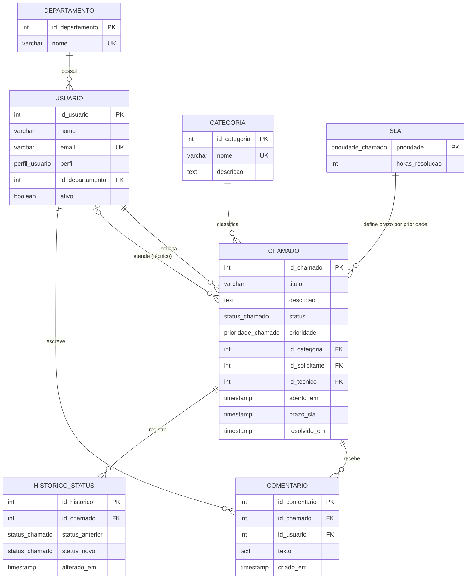

# Sistema de Gerenciamento de Chamados — Banco de Dados PostgreSQL

**Instituto Federal do Paraná (IFPR) — Campus Palmas/PR**
Disciplina: **Banco de Dados 2** · Professora: **Bruna Francieli Kwiatkovski**
Aluno: **Thiago J. Costa**

---

## Sobre o trabalho

Banco de dados de um sistema de **chamados de suporte (help desk)**, como o que uma empresa usa para o setor de TI atender pedidos dos funcionários: alguém abre um chamado (impressora parada, VPN fora do ar, senha esquecida), um técnico assume, acompanha e resolve, e tudo fica registrado.

O trabalho exige três recursos do PostgreSQL, implementados e demonstrados:

| Requisito | Arquivo | Aplicação no tema |
|---|---|---|
| **Views** | `sql/03_views.sql` | Consultas prontas para o dia a dia da equipe de suporte |
| **Funções** | `sql/02_funcoes.sql` | Regras de negócio no banco: abrir e atribuir chamados, calcular SLA |
| **Transações** | `sql/05_demonstracao.sql` | Operações "tudo ou nada", com `COMMIT`, `ROLLBACK` e `SAVEPOINT` |

## Ferramentas utilizadas

- **PostgreSQL 18**, executando em um contêiner **Docker** (`docker_Db`), a partir da imagem oficial: [Docker Hub](https://hub.docker.com/_/postgres) · [repositório](https://github.com/docker-library/postgres);
- **pgAdmin 4**, a interface web do PostgreSQL, também em contêiner Docker, usada para criar o banco, executar os scripts e interagir com os dados: [Docker Hub](https://hub.docker.com/r/dpage/pgadmin4) · [documentação do contêiner](https://www.pgadmin.org/docs/pgadmin4/latest/container_deployment.html) · [repositório](https://github.com/pgadmin-org/pgadmin4);
- **Mermaid**, para o diagrama deste README: [documentação](https://mermaid.js.org) · [repositório](https://github.com/mermaid-js/mermaid);
- **draw.io (diagrams.net)**, para o diagrama do modelo de dados, em `modelo_chamados.drawio`: [site](https://www.drawio.com) · [repositório](https://github.com/jgraph/drawio);
- **Git / GitHub**, para versionamento e entrega.

## Como o projeto está organizado

Os scripts são executados na ordem abaixo, no banco `chamados_db`. O `05` roda por blocos, pois mostra transações e erros propositais.

| Ordem | Arquivo | Conteúdo |
|---|---|---|
| 1 | `sql/01_schema.sql` | Tabelas, tipos, restrições e índices (schema `chamados`) |
| 2 | `sql/02_funcoes.sql` | Funções e triggers |
| 3 | `sql/03_views.sql` | Views |
| 4 | `sql/04_dados.sql` | Dados de exemplo |
| 5 | `sql/05_demonstracao.sql` | Demonstração de views, funções e transações |

## Modelo de dados

Cada chamado tem categoria (Hardware, Software, Rede, Acesso), prioridade (`BAIXA` a `CRITICA`) e status (`ABERTO`, `EM_ATENDIMENTO`, `AGUARDANDO_CLIENTE`, `RESOLVIDO`, `FECHADO`, `CANCELADO`). Usuários têm perfil `CLIENTE`, `TECNICO` ou `ADMIN`.

## Funcionalidades

### Views — o painel da equipe de suporte
| View | Para que serviria no dia a dia |
|---|---|
| `vw_chamados_detalhado` | Tela principal do help desk: chamado, solicitante, técnico e se o prazo (SLA) está em dia ou atrasado |
| `vw_chamados_pendentes` | Fila de trabalho do técnico, dos mais críticos para os menos |
| `vw_desempenho_tecnico` | Relatório do gestor: quanto cada técnico resolveu e em quanto tempo |
| `vw_resumo_categoria` | Onde estão os problemas: quantos chamados por categoria e status |

### Funções e triggers — regras que o banco aplica sozinho
| Objeto | O que faz |
|---|---|
| `fn_abrir_chamado` | Registra um novo chamado e devolve o número |
| `fn_atribuir_chamado` | Passa o chamado a um técnico, recusando quem não é técnico ativo ou chamado que já foi assumido |
| `fn_calcula_prazo_sla` | Calcula o prazo de resolução pela prioridade (ex.: crítico = 4 h, baixo = 72 h) |
| `fn_carga_tecnico` | Quantos chamados o técnico tem em andamento, útil para distribuir o trabalho |
| `fn_horas_resolucao` | Tempo gasto para resolver um chamado |
| Triggers | Definem o prazo ao abrir o chamado, gravam o histórico de cada mudança de status e impedem reabrir um chamado já fechado |

### Transações — nada fica pela metade
| Caso | Exemplo prático |
|---|---|
| `COMMIT` | Abrir o chamado e o comentário inicial juntos |
| `ROLLBACK` | Desfazer uma alteração de prioridade feita por engano |
| `SAVEPOINT` | Descartar só um comentário errado sem perder a atribuição do chamado |
| Reatribuição | Passar todos os chamados de um técnico para outro de uma vez |
| `ROLLBACK` por erro | Tentar atribuir um chamado a um cliente: a função recusa e a alteração anterior é desfeita |
